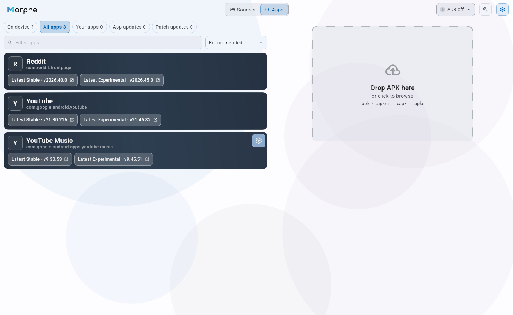
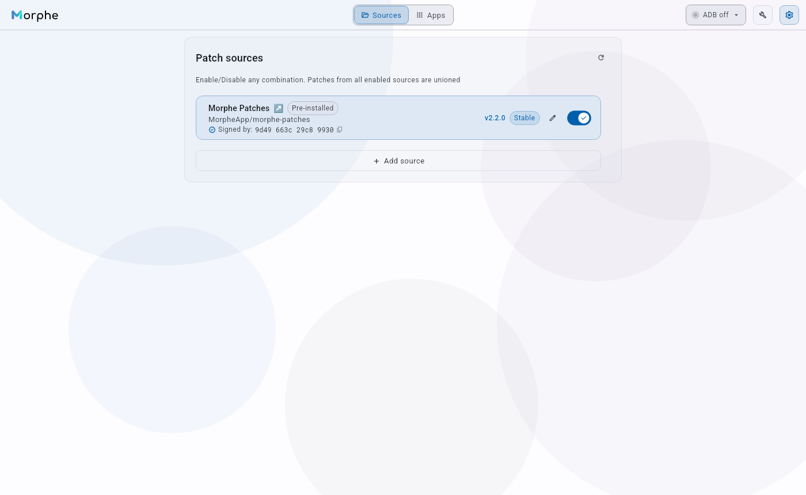

# Morphe Desktop Custom

**Unofficial community-maintained fork of [Morphe Desktop](https://github.com/MorpheApp/morphe-desktop).** Independent of and not endorsed by the original Morphe project. The original project's name, logos and trademarks belong to their respective owners. See [LICENSE](LICENSE) and [NOTICE](NOTICE), including the additional GPLv3 Section 7 conditions.

[**Download the public Windows beta (2.1.1-beta.2)**](https://github.com/lxsdd/morphe-desktop-public/releases/tag/custom-v2.1.1-beta.2) · [Release details and reproducibility](docs/PUBLIC_BETA_2_1_1.md) · [Full documentation](docs/documentation.md)

> **Beta notice:** This is a public preview, not an official Morphe release or a guarantee that a particular patched app will work on your device. The private development repository, user data, credentials and private builds are not published here.

## What's in this Custom edition?

Morphe Desktop Custom is a desktop **GUI and CLI** for patching Android apps using compatible Morphe Patcher bundles. This public **2.1.1-beta.2** hotfix includes the current device-oriented Custom interface and the owner-reviewed application source, with the following improvements:

| Area | Features |
| --- | --- |
| **Apps on your device** | Read-only ADB inventory for the **selected device**, with installed app names and versions, source compatibility and detail views. Package names remain visible when a friendly label is unavailable. Cached app labels avoid repeatedly resolving unchanged apps. |
| **Updates and filtering** | Separate views for **app updates** and **patch updates**, plus your apps and on-device inventory. Status filters, sorting and explicit scanning/loading states help distinguish observed device facts from patch catalog suggestions. |
| **APK patching** | Streamlined **Simple mode**, full **Expert mode**, supported APK / split-bundle inspection, multi-source patch selection, patch options and detailed progress/results. A different APK selected by the user is the input for the next patch operation. |
| **Patch sources and trust** | Source management, version/update information, informative compatibility errors for older patch bundles, signer verification and explicit trust decisions. Saved sources are not reset merely because one becomes incompatible. |
| **Installation** | Explicit ADB installation of a verified patched APK to the **chosen device**. A separate **Install existing APK** option supports a fresh install on a device where the app is absent, without patching again. Existing installations, ambiguous ownership and uncertain inputs fail closed; no silent uninstall/downgrade or other-device fallback. |
| **UI and dialogs** | Consistent close/dismiss behavior for overlays, clearer confirmation dialogs and error messages, improved responsive layouts and native app-name display where available. |
| **Safety** | APK identity and SHA-256 checks, read-only package/owner probes, exact-device targeting and warnings about signer or Android update-ownership mismatches. No claim that successful ADB installation suppresses Google Play update offers. |

### Current interface

Screenshots below are captured from the **real 2.1.1 application** on a clean Linux desktop session without connected Android devices or personal patch sources. Your colors, language, installed apps and available sources may look different on Windows.

| Apps / device workspace | Patch source management |
| --- | --- |
|  |  |

Earlier compiled Patcher 1.x community MPP bundles now enter the official Patcher 2.x backward-compatible loader instead of being rejected solely by major version. Three SHA-256 pinned published MPPs are covered by read-only class-load tests. This does not guarantee individual Android APK patch success.

## Download and run on Windows

1. Download `Morphe-Desktop-Custom-2.1.1-BETA2-*.zip` from the [public release](https://github.com/lxsdd/morphe-desktop-public/releases/tag/custom-v2.1.1-beta.2). Check the associated `SHA256SUMS.txt` if you want to verify the download.
2. Extract the entire ZIP to a folder of your choice; don't run the launcher from inside the archive.
3. Run `Start-Morphe-Windows.cmd`. You need **Java 21 or newer** for a direct JAR launch; the release documentation covers the packaged Windows launcher.
4. Open **Sources** to review patch bundles and their compatibility, then use **Apps** to choose an APK or inspect a connected, authorized ADB device. Select patches and any installation target yourself.

The application may fetch verified platform-specific GUI libraries on its first GUI start. No third-party Android APK, signing key or patch source is included in the release ZIP. **Do not install an APK whose provenance you do not trust.**

### Install an already patched APK without repatching

Connect and authorize the Android device with ADB, then select **Apps → On device → Install existing APK** (German UI: **Apps → Auf Gerät → Vorhandene APK installieren**). Select a single `.apk`, review the read-only validation and choose the precise target device. Installation requires a second confirmation and is intended for an app **not already installed** there. It does not migrate, replace, downgrade or uninstall an existing app.

For a newly downloaded source APK to be patched, select that **new file** in the patch workflow; an older cached APK is not silently substituted.

## CLI

The beta also supports the command line. With Java 21+ and a compatible, trusted `.mpp` bundle:

```bash
java -jar morphe-desktop-*-all.jar patch -p patches-*.mpp your_app.apk
```

Use the actual JAR filename in place of `*` if your shell does not expand wildcards. Upstream Homebrew packages and official upstream builds are **not** this Custom fork.

## Limitations and trust boundaries

- Supported patches depend on the **patcher major version, the patch bundle, the target app and its version**. Old bundle URLs are not guaranteed to work with Patcher 2.3.0. The app distinguishes incompatible old sources from ordinary network/update errors.
- A new available patch version does not prove it is applicable to every installed app. App updates, patch updates and actual installed patch evidence are shown separately.
- Android signing certificates, installer attribution, Android update ownership and **Google Play update offers** are different concepts. Replacing an app from Google Play with a differently signed APK can be blocked. The optional `Disable Play Store updates` patch has significant version-code and rollback trade-offs and is never enabled silently.
- Source tests on Ubuntu, Windows and macOS and a verified public Windows ZIP do not constitute tests on every Android device, or acceptance of any particular APK installation.

For source and safety details, see [public beta verification](docs/PUBLIC_BETA_2_1_1.md), [documentation](docs/documentation.md) and [release checksums](https://github.com/lxsdd/morphe-desktop-public/releases/tag/custom-v2.1.1-beta.2).

## Build from source

Use a JDK 21 toolchain. From this public repository's checked-out release commit:

```bash
python tools/verify_public_beta_source_manifest.py
./gradlew build --no-daemon
```

The [manifest](tools/public_beta_source_manifest.tsv) binds application, resources, build files and tests to the accepted source snapshot. The public beta source and release are distinct from the private development workspace. Contributions should follow [CONTRIBUTING.md](CONTRIBUTING.md).

## License and attribution

Distributed under the terms of [GPLv3](LICENSE), subject to the original project's additional terms in [NOTICE](NOTICE) (including attribution and branding restrictions under GPLv3 Section 7). This repository's title and disclaimer identify it as an unofficial community fork; neither the original trademark nor upstream affiliation is claimed.
