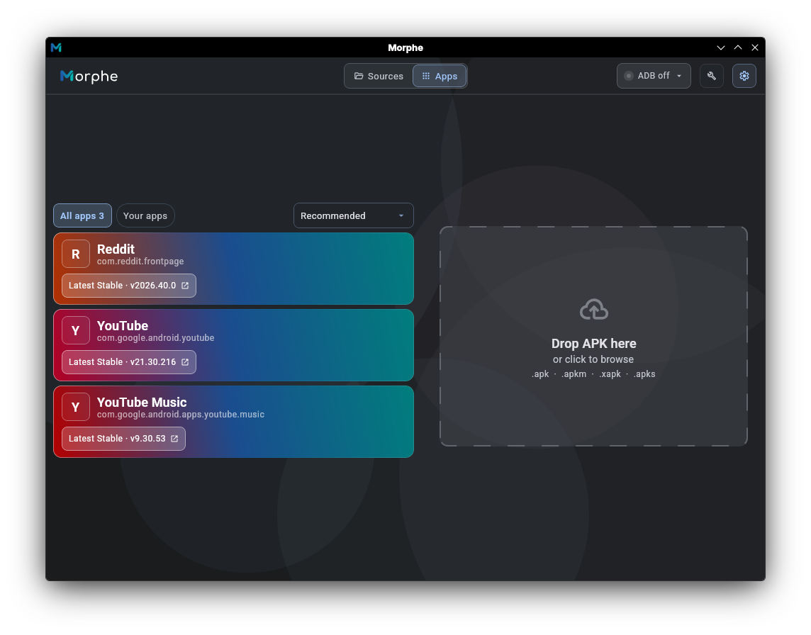
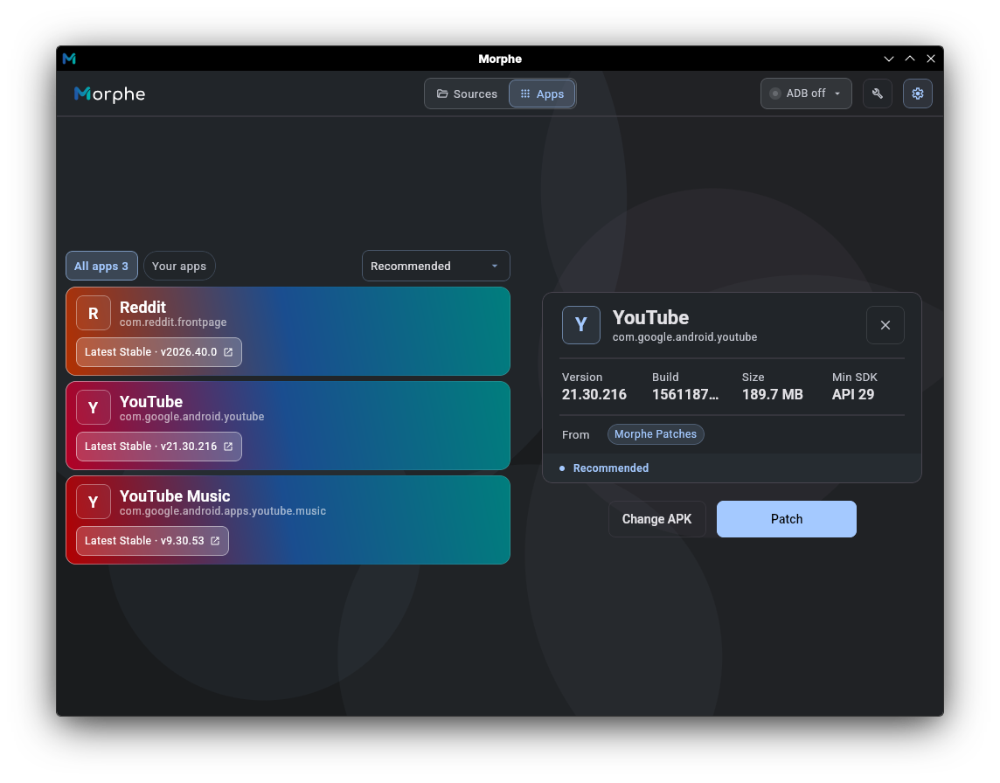
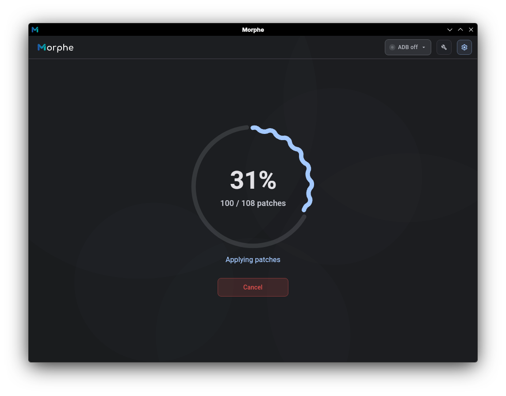
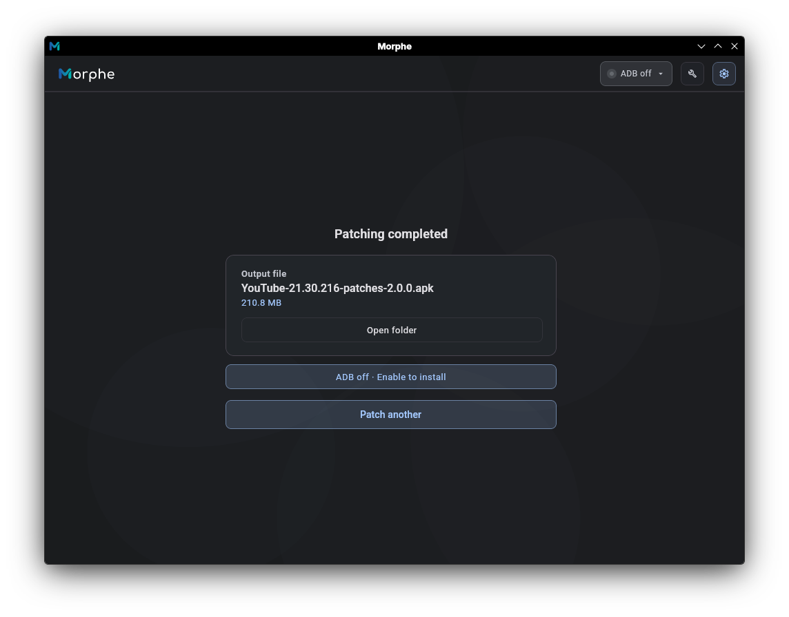

# Morphe Desktop Custom — unofficial community fork

> **Independent, unofficial derivative.** Not endorsed by the original Morphe
> maintainers. The Morphe name, marks and brand assets remain with their
> owners. See [NOTICE](NOTICE) for additional GPLv3 Section 7 conditions.

**2.1.1 public beta:** [releases](https://github.com/lxsdd/morphe-desktop-public/releases)
· [Features, source parity and verification](docs/PUBLIC_BETA_2_1_1.md).

<h1 align="center">Morphe Desktop</h1>


## About
Morphe Desktop is a command-line and a GUI application that uses [Morphe Patcher](https://github.com/MorpheApp/morphe-patcher) to patch Android apps.

Morphe Desktop's CLI is based on the prior work of [ReVanced](https://github.com/ReVanced/revanced-cli).
The GUI is developed by the Morphe team.
All modifications made by Morphe can be found in the Git history.


## Prerequisites
1. Java Runtime Environment 21 or above ([Azul Zulu JRE](https://www.azul.com/downloads/?version=java-21-lts&package=jre#zulu), [Temurin](https://adoptium.net/temurin/releases?version=21&os=any&arch=any) or [OpenJDK](https://jdk.java.net/archive/)).
2. Morphe Desktop jar file (morphe-desktop-*-all.jar). Download this unofficial beta from [this repository's releases](https://github.com/lxsdd/morphe-desktop-public/releases). Official upstream builds are a separate product.

   **Alternative: Homebrew (macOS/Linux).** Install [Homebrew](https://brew.sh), then run `brew install morphe`. Homebrew installs OpenJDK as a dependency. Run `morphe --help` to get started. See the [Morphe formula](https://formulae.brew.sh/formula/morphe).
3. If using CLI: Patches MPP file (patches-*.mpp). Download the latest Morphe official patch files from [here](https://github.com/MorpheApp/morphe-patches/releases/latest).
4. Desired app file (app.apk or app.apkm). Download your apk from [APK Mirror](https://www.apkmirror.com/).
5. [Optional] [Android Debug Bridge (ADB)](https://developer.android.com/studio/command-line/adb) If you want to install the patched APK file to your device directly from your computer.

## Documentation
Learn how to use Morphe Desktop by following the [documentation](/docs/documentation.md).

## Getting Started
Morphe Desktop is a powerful little application that allows you to patch and install(via ADB) android apps. Although sticking to the suggested apps is recommended, 
you can try and experiment with other apps to your hearts content!

Morphe Desktop runs in two modes:
- CLI: You can run the CLI mode by directly calling it in your preferred terminal.
- GUI: You can run the GUI mode by double-clicking the .jar file. This will open the Morphe Desktop window.

While there are a lot of things that you can do and explore, for the time being in this section, we'll focus on running our first patching and getting a patched apk with the CLI and GUI.

> [!TIP]
> If this your first time using Morphe Desktop, head over to the [GUI](#gui) section instead of [CLI](#cli). 
> Once you get the hang of things, you can start tinkering with the CLI!

### First Run

#### GUI
The GUI is far more user-friendly and straightforward than the CLI. On your first run it opens in **Simple mode** (the streamlined default path).

##### Steps:
1. Double-click the downloaded `morphe-desktop-*-all.jar`. It should open like this:



> [!NOTE]
> **First launch only.** Morphe ships as a single small jar. The command-line tool runs on its own, but the GUI needs a couple of platform-specific components (the Skiko renderer and JNA) that aren't bundled, so the download stays small. The **first** time you open the GUI, Morphe fetches the right components for your operating system into `morphe-data/libs/` and shows a brief setup window before the home screen appears. This happens only once. Later launches reuse the cached files and need no internet connection.

2. Drag and drop your `.apk` (or `.apkm` / `.xapk` / `.apks` bundle) into the window. Once it's analyzed, select your preferred patch source from the dropdown if multiple sources support the app, then click **Patch** to begin:



3. Patching starts and streams its progress. You'll see something like this:



> [!NOTE]
> If you run into any issues or errors, head over to the [documentation](/docs/documentation.md).


4. When it finishes you'll land on the result screen. Copy the patched APK to your device and install it, or with ADB enabled, install it straight from Morphe.



Bravo! That's your first successful patch! When you're ready for granular control (selecting individual patches and editing patch options), switch on **Expert mode** in Settings. You can also manage patch sources anytime using the **Sources** tab in the top navigation bar. See the [documentation](docs/documentation.md).


#### CLI
Following the [prerequisites](#prerequisites) section will get you the two basic but very required files for most patching:
- morphe-desktop-*-all.jar file
- patches-*.mpp

Ideally place both of these files and your desired apk (preferably YouTube for your first run) file in the same folder for now to avoid path headaches.

##### Steps:
1. Open the terminal in the folder you have placed your files. If you are not in that folder, go there by:
    ```
    cd path/to/your/folder
    ```

2. Run the `ls` command if required to check the contents of the folder and confirm that you have all the files over there.

3. Now run the patch command to instruct the morphe-desktop.jar to run the patching process by using the patch command on your apk file like this:
    ```sh
    # Downloaded JAR:
    java -jar morphe-desktop-*-all.jar patch -p patches-*.mpp your_app.apk

    # Homebrew:
    morphe patch -p patches-*.mpp your_app.apk
    ```
4. This should start the patching process. You should be able to see a bunch of patches being applied like such:
    ```
    INFO: Loading patches 
    INFO: Decoding app manifest
    INFO: Setting patch options
    INFO: "Override certificate pinning" disabled
    .
    .
    .
    .
    .
    INFO: Aligning APK 
    INFO: Signing APK
    INFO: Saved to /your/path/your_app-patched.apk
    ```

> [!NOTE]
> If you run into any issues or errors, please head over to the [documentation](/docs/documentation.md).

5. You should now have a patched apk with the name of:
    ```
    your_app-patched.apk
    ```
Voilà! This is your final patched apk. Go ahead, install this apk on your device and try it out!

Now head over to the [documentation](/docs/documentation.md)

[//]: # (## Everything else)
## Contributing
Thank you for considering contributing to Morphe Desktop.
You can find the contribution guidelines [here](CONTRIBUTING.md).


[//]: # (### Building)

[//]: # (To build Morphe Desktop, you can follow the [documentation]&#40;/docs&#41;.)


## License
Morphe Patches are licensed under the [GNU General Public License v3.0](LICENSE), with additional conditions under GPLv3 Section 7:

- **Attribution (7b):** Any use of this code, including derivative works, must preserve all original notices and disclaimers.
- **Name & Branding Restrictions (7c & 7e):** Derivative works must use their own distinct branding. The **"Morphe"** name, logos, and trademarks may not be used for the branding or title of derivative works (e.g., names like *"Morphe Plus"*, *"Morphe Expanded"*, or *"Morphe UserXYZ"* are strictly prohibited).

See the [LICENSE](LICENSE) file for the full GPLv3 terms and the [NOTICE](NOTICE) file for full conditions of GPLv3 Section 7
